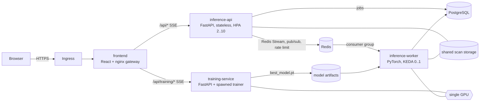

# BrainMriSegmentation

Whole-tumor glioma segmentation on multimodal 3D MRI (BraTS 2023: T1, T1Gd, T2, T2-FLAIR), built on and extending
*"Advancing Glioma Segmentation: A Robust 3D Residual Attention U-Net Framework for Multimodal MRI Images"* (Das et al., ICCA 2024).

The system trains the **Modality-Aware Attention U-Net** with the **Tumor-Aware loss**, streams training live to a web
dashboard over Server-Sent Events, and serves inference through a queue-based pipeline sized for one GPU and thousands of requests.

## Architecture



| Path | Responsibility |
|---|---|
| `backend/segmentation-core` | Shared library: settings, preprocessing, datasets, model, loss, metrics, sliding-window prediction, checkpoints. `settings.py` is torch-free so the inference API image stays slim. |
| `backend/training-service` | Training microservice. Clean architecture: `domain`, `application` (trainer, session use cases, ports), `infrastructure` (spawned process, history repository), `presentation` (controllers, schemas). |
| `backend/inference-service` | Two deployables from one package: `inference_service.main` (API) and `inference_service.worker` (GPU worker). Same layering, with PostgreSQL, Redis and file-storage adapters. |
| `frontend` | React (Vite) dashboard and the nginx gateway that routes `/api/training/*` and `/api/*`. |
| `deploy/kubernetes` | Kustomize base plus `local` (Docker Desktop) and `gpu` (NVIDIA) overlays. |

## Model: Modality-Aware Attention U-Net

The published 3D Residual Attention U-Net is the starting point. Its residual dual-path encoder (convolution path plus max-pool
skip path, summed) and its CBAM channel and spatial attention are kept. The changes below are new combinations and modifications
designed for this task. They are motivated choices, not results: each needs an ablation on BraTS before any claim of benefit.

| Component | Design | Rationale |
|---|---|---|
| Modality-aware stem | Each MRI sequence gets its own convolution path (grouped convolutions). A cross-modality exchange gate pools every path, mixes them through a shared bottleneck and applies a per-channel softmax across modalities before fusion, alongside a joint projection of the raw stack. | Implements the future work named in the paper's conclusion: process each modality differently, with knowledge shared among paths. The softmax lets each feature channel choose which sequence to trust (for example T1Gd for enhancing tumor, FLAIR for edema). |
| Residual dual-path downsampling | Stride-2 convolution path plus max-pool and 1x1 projection path, summed. | The paper's encoder block, kept as the downsampling unit. |
| Cross-stage partial blocks | 3D version of the YOLOv8 C2f / YOLO11 C3k2 block with residual bottlenecks, learnable layer scale and stochastic depth. | Many gradient paths at low compute cost. |
| Axis-rotating area attention | YOLOv12 area attention generalised to 3D: tokens are split into slabs, attention runs inside each slab through `scaled_dot_product_attention` (Flash / memory-efficient kernels). Consecutive blocks rotate the slab axis D, H, W. A depthwise 5x5x5 convolution on the values adds position information. | A single fixed axis leaves cross-slab interactions to later layers. Rotating the axis gives every token a full 3D receptive field after three blocks, still at area-attention cost. Applied at 1/8 resolution (4 slabs) and globally at 1/16. |
| Spatial pyramid pooling (SPPF) | YOLO SPPF in 3D at the bottleneck. | Multi-scale context for tumors of very different sizes. |
| Gated skip connections | CBAM channel and spatial attention on every encoder skip before it joins the decoder. | The paper's attention, applied where it filters what the decoder receives. |
| Deep supervision | Auxiliary heads at 1/2 and 1/4 resolution, weights 1, 1/2, 1/4. | Stronger gradients to the middle of the network. |
| Normalisation | InstanceNorm and GroupNorm instead of BatchNorm. | Batch size 2 makes BatchNorm statistics noisy. |

About 10.8 million parameters (the published model has 7.5 million).

## Loss: Tumor-Aware loss

One loss, three terms, computed per sample:

1. **Focal Tversky** (false-negative weight 0.7, exponent 0.75): missed tumor costs more than a false alarm, and easy volumes contribute less.
2. **Boundary-band focal BCE**: the paper's focal term, with each voxel weighted by `1 + w * progress * band`, where `band` is the tumor
   boundary obtained on the GPU by dilation minus erosion. `progress` rises from 0 to 1 over training, so the model learns the bulk of the
   tumor first and the boundary later. Boundary voxels decide most of the remaining Dice and IoU error.
3. **Soft volume consistency** (weight 0.5): relative error between predicted and true tumor volume, applied only to samples that contain
   tumor. It targets systematic over- or under-segmentation, and tumor volume is the quantity clinicians read from the mask.

## Training on a 12 GB GPU (RTX 3060)

| Technique | Effect |
|---|---|
| bfloat16 autocast on Ampere and newer (float16 with loss scaling otherwise) | Roughly half the activation memory, faster convolutions. |
| Gradient checkpointing of the two highest-resolution stages | Recomputes the largest activations during backward instead of storing them. |
| Automatic micro-batch fitting | A forward/backward probe against the GPU memory actually free; if batch 2 does not fit, it trains with micro-batch 1 and 2-step gradient accumulation. |
| Fused AdamW, warm-up and cosine schedule, gradient clipping | Stable optimisation in the style of Hugging Face Trainer. |
| Exponential moving average of weights | The averaged weights are validated, saved and served. |
| Tumor-aware patch sampling (33 percent of patches contain tumor) | Addresses class imbalance at the data level. |
| GPU augmentation and modality dropout; augmentation stops for the last 5 epochs | YOLO "close mosaic" idea: the final epochs see clean data. |
| Preprocessed float16 cache read with memory mapping | Each case is decoded from `.nii.gz` once; later epochs read only the bytes of the sampled patch. |
| Gaussian-weighted sliding windows; flip test-time augmentation at inference | Smoother predictions at window borders. |

## Inference at scale on one GPU

* The API never touches the GPU. It streams uploads to shared storage while hashing them, validates NIfTI headers, records the job in
  PostgreSQL and appends it to a Redis Stream. It answers `202 Accepted` with the job, its queue position and a `Location` header.
* Identical uploads (same SHA-256 across all files) reuse the existing job instead of spending GPU time again.
* Back-pressure: per-client rate limiting (`429` with `Retry-After`) and a maximum queue length (`429` with an estimated wait).
* The worker reads the stream through a consumer group: at-least-once delivery. A job left unacknowledged by a crashed worker is
  reclaimed after `INFERENCE_JOB_RECLAIM_IDLE_SECONDS` and retried up to `INFERENCE_MAXIMUM_JOB_ATTEMPT_COUNT` times.
* With one GPU, more worker pods would only contend for it. KEDA scales the worker between 0 and 1 replicas from the stream lag and pending
  entries. At zero, the GPU memory is free for training. When both run, the worker caps its share with `INFERENCE_GPU_MEMORY_FRACTION`,
  and the trainer's memory probe sizes its batch from the memory that is actually free.
* Job status is pushed to the browser over SSE (`/api/segmentations/{id}/events`), backed by Redis pub/sub so it works across API replicas.
* Completed jobs older than `INFERENCE_JOB_RETENTION_DAYS` are deleted with their files.

## Running with Docker Compose

1. Put the BraTS 2023 training data in `./data` (or set `DATASET_DIRECTORY`):
   `data/BraTS-GLI-00000-000/BraTS-GLI-00000-000-{t1n,t1c,t2w,t2f,seg}.nii.gz`
2. Create `.env` from `.env.example` and set strong passwords (hex characters, because they are embedded in connection URLs).
3. Start the stack:
   * CPU only: `docker compose up -d --build`
   * NVIDIA GPU: `docker compose -f docker-compose.yml -f docker-compose.gpu.yml up -d --build`
4. Open `http://127.0.0.1:8080`. Only the gateway is published, and only on the loopback interface.

The code always uses the GPU when one is visible to the container and falls back to the CPU otherwise.

## Running on Kubernetes

Prerequisites: an NGINX ingress controller and, for the `gpu` overlay, KEDA and the NVIDIA GPU Operator.

```
cp deploy/kubernetes/overlays/local/secrets.env.example deploy/kubernetes/overlays/local/secrets.env
docker compose build
kubectl apply -k deploy/kubernetes/overlays/local
```

* `local` targets Docker Desktop: the dataset is a hostPath volume (edit `overlays/local/dataset-volume.yaml` if the repository lives
  elsewhere), storage is `ReadWriteOnce`, and one worker replica runs without KEDA.
* `gpu` adds `nvidia.com/gpu` limits and node selection, TLS on the ingress, KEDA scale-to-zero for the worker and a time-slicing
  configuration (`glioma-segmentation-time-slicing` in `gpu-operator`). Point the GPU Operator device plugin at that ConfigMap so
  training and the inference worker can share the single GPU.
* Shared volumes (`model-artifacts`, `inference-storage`) need a `ReadWriteMany` storage class on multi-node clusters.
* Secrets are generated from the git-ignored `secrets.env` of each overlay.

## Configuration

All settings are environment variables. Model and training settings use the `SEGMENTATION_` prefix
(`backend/segmentation-core/segmentation_core/settings.py`). Inference infrastructure settings use the `INFERENCE_` prefix
(`backend/inference-service/inference_service/configuration.py`). Frequently changed ones:

| Variable | Default | Meaning |
|---|---|---|
| `SEGMENTATION_EPOCH_COUNT` | 60 | Maximum epochs (early stopping patience 15). |
| `SEGMENTATION_BATCH_SIZE` | 2 | Effective batch; micro-batch and accumulation are fitted to the GPU. |
| `SEGMENTATION_PATCH_SHAPE` | 128,128,128 | Training and sliding-window patch. |
| `SEGMENTATION_IS_TEST_TIME_AUGMENTATION_ENABLED` | true | Flip TTA in the worker (four forward passes per window). |
| `INFERENCE_MAXIMUM_QUEUE_LENGTH` | 200 | Active jobs accepted before returning `429`. |
| `INFERENCE_RATE_LIMIT_REQUESTS_PER_MINUTE` | 30 | Submissions per client per minute. |
| `INFERENCE_GPU_MEMORY_FRACTION` | 0.35 | Share of GPU memory the worker may use. |

## HTTP API

Training service: `GET /api/training/health`, `GET /api/training/status`, `GET /api/training/dataset`,
`GET /api/training/events` (SSE), `POST /api/training/start`, `POST /api/training/stop`.

Inference API: `GET /api/health/live`, `GET /api/health/ready`, `GET /api/model`, `GET /api/queue`,
`POST /api/segmentations` (multipart `t1n`, `t1c`, `t2w`, `t2f`, optional `seg`), `GET /api/segmentations`,
`GET /api/segmentations/{id}`, `GET /api/segmentations/{id}/events` (SSE),
`GET /api/segmentations/{id}/slices/{index}/image?modality=`, `GET /api/segmentations/{id}/slices/{index}/mask?source=`,
`GET /api/segmentations/{id}/mask`, `DELETE /api/segmentations/{id}`.

Interactive documentation is served by each FastAPI service at `/docs` inside the cluster network.

## Development

* `pyrightconfig.json` maps the monorepo packages for Pylance and Pyright.
* Frontend: `cd frontend && npm install && npm run dev` (proxies to the services on ports 8000 and 8001).
